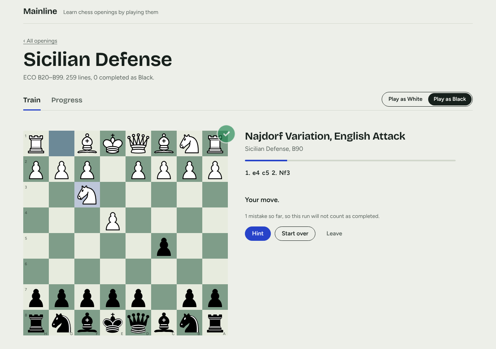

# Mainline: learn chess openings by playing them

A free, open-source chess opening trainer that runs entirely in your browser.
Pick an opening, play its lines on the board, and get corrected the moment you
leave the book. No account, no server, no paywall.



## What it does

- **149 openings, about 2,500 lines.** Sicilian, Ruy Lopez, Italian, French,
  Caro-Kann, Queen's Gambit, King's Indian and the rest, searchable by name,
  variation or ECO code.
- **Train.** You play your side and the other side answers. Any book move of
  the opening is accepted with a ✓. Anything else gets a ✕ and is taken back.
- **Hint.** Rings the piece you should move. Press again to see the move.
- **Progress tree.** Every line and subline of the opening as a tree, with the
  ones you have completed ticked. Click a line to drill it; in a drill only
  that line's exact moves are accepted.
- **Completed means from memory.** A line is ticked off once you play it
  start to finish with no mistakes and no hints.
- **Keep playing against Stockfish.** At the end of a line you can play on.
  Stockfish picks at random among its top three moves, and your move is
  accepted if it is one of the top three too. Moves that lose more than 0.99
  pawns against the best move never count, for either side.
- **Play as White or Black.** Progress is tracked separately for each colour
  and stored in your browser.

## Run it locally

You need [Node.js](https://nodejs.org) 20 or later.

```bash
git clone https://github.com/<you>/learn-chess-openings.git
cd learn-chess-openings
npm install
npm run dev
```

Then open the address it prints (usually http://localhost:5173).

| Command | What it does |
| --- | --- |
| `npm run dev` | Start the app on localhost with live reload |
| `npm run build` | Type-check and build the static site into `dist/` |
| `npm run preview` | Serve the built site locally |
| `npm run data` | Re-download the openings from Lichess and rebuild `src/data/openings.json` |

## Put it online with GitHub Pages

The repository ships with a workflow that builds and publishes the site on
every push to `main`. Turn it on once: **Settings > Pages > Source > GitHub
Actions**. The app uses relative paths and hash routes, so it works under
`https://<you>.github.io/learn-chess-openings/` with no extra configuration.

## How it is built

| Part | Where | Notes |
| --- | --- | --- |
| Openings | `src/data/openings.json` | Generated by `scripts/build-openings.mjs` from the [Lichess openings dataset](https://github.com/lichess-org/chess-openings) (CC0). Variations are grouped by opening and turned into a move tree; the tree's endpoints are the lines you train. |
| Rules | [chess.js](https://github.com/jhlywa/chess.js) | Move generation and validation |
| Board | [Chessground](https://github.com/lichess-org/chessground) | The Lichess board |
| Engine | [Stockfish.js](https://github.com/nmrugg/stockfish.js) | Single-threaded "lite" WASM build in a Web Worker, so it needs no special server headers. Copied into `public/engine/` by `scripts/copy-engine.mjs`. |
| App | `src/` | React, TypeScript, Vite. No backend. |

The interesting files:

- `src/lib/openings.ts` builds the move tree and picks the next line.
- `src/components/Trainer.tsx` is the training loop (book phase, then Stockfish).
- `src/components/ProgressTree.tsx` draws the progress tree.
- `src/lib/engine.ts` talks to Stockfish.
- `src/lib/progress.ts` saves progress to `localStorage`.

## Licence

GPL-3.0-or-later, because Stockfish and Chessground are GPL-3.0. See
[LICENSE](LICENSE). The openings data is CC0.
